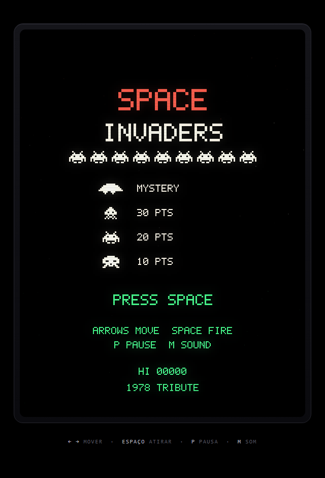
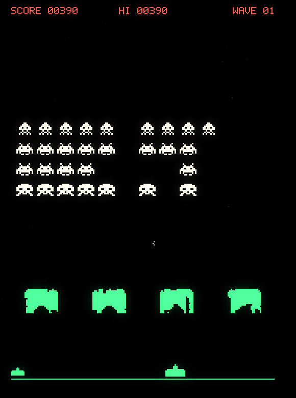

# Space Invaders — tribute build

Um Space Invaders de arcade feito à mão em canvas: sprites em bitmap, escudos que
erodem célula a célula, disco voador misterioso e a marcha que acelera conforme a
frota diminui. Sem dependências, sem build, sem servidor.



## Jogar

Abra `index.html` — duplo clique basta. O jogo roda inteiro no navegador, inclusive
o som, e funciona offline.

Se preferir servir por HTTP:

```sh
cd space-invaders
python -m http.server 8000
# http://localhost:8000
```

O áudio só começa depois da primeira tecla, porque os navegadores exigem um gesto
do usuário para liberar o `AudioContext`.

## Controles

| Tecla | Ação |
| --- | --- |
| `←` `→` ou `A` `D` | mover a nave |
| `Espaço` | atirar |
| `P` ou `Esc` | pausar |
| `M` | ligar/desligar o som |
| `Enter` | começar / reiniciar |

Em telas de toque aparecem três botões abaixo do gabinete: esquerda, fogo e direita.
O recorde fica salvo no `localStorage` do navegador (chave `si.hi`).

## Regras

- A frota tem 11 × 5 alienígenas e marcha em passos: ao bater na borda, desce um
  degrau e inverte. A velocidade cresce conforme as unidades morrem — é o que
  transforma o começo tranquilo no fim desesperador.
- Você tem **um único tiro na tela**. Errar custa tempo, não munição.
- Os quatro escudos erodem célula a célula. Seus tiros também os furam, então
  atirar de baixo da própria cobertura é um péssimo hábito.
- O disco voador cruza o topo de vez em quando e vale pontos aleatórios.
- Vida extra aos 1500 pontos.
- Se a frota chegar na altura da nave, acabou.
- Cada onda traz frota e escudos novos, mantendo pontos e vidas.

### Pontuação

| Alvo | Pontos |
| --- | --- |
| Polvo (fileira de baixo) | 10 |
| Caranguejo (fileiras do meio) | 20 |
| Lula (fileira de cima) | 30 |
| Disco voador | 50, 100, 150 ou 300 |



## Como é feito

Tudo está em `game.js` (cerca de mil linhas) e `index.html` (moldura e controles). Sem
bibliotecas, sem bundler, sem assets: nenhum arquivo de imagem ou áudio é carregado.

**Renderização.** O canvas lógico é 560 × 760 e escala por CSS com
`image-rendering: pixelated`, então os sprites continuam nítidos em qualquer tela.
Sprites são mapas de bits de 8 × 8 pré-renderizados em canvas fora de tela; a fonte
5 × 7 dos placares é desenhada pixel a pixel com `fillRect`.

**As faixas coloridas.** O gabinete original tinha um overlay de celofane —
vermelho no topo, branco no meio, verde embaixo. Aqui as três faixas são aplicadas
com `globalCompositeOperation = 'multiply'`, o que tinge o que está desenhado e
mantém o preto intacto. É por isso que a frota muda de cor conforme desce e que o
título é vermelho em cima e branco embaixo.

**Brilho de fósforo.** O quadro é reduzido para 140 × 190, borrado com
`ctx.filter = 'blur(2px)'` e recomposto com `lighter` a 18% de opacidade. Scanlines
e vinheta ficam em CSS, sobre o canvas.

**Áudio.** 100% sintetizado com WebAudio: osciladores quadrados na marcha de quatro
notas, no tiro e nos bônus; dente-de-serra e ruído branco nas explosões. A marcha é
disparada por distância percorrida, então acelera junto com a frota.

**Lógica.** Passo fixo de 1/60 s com acumulador (até 5 passos por quadro), colisão
por retângulos e escudos por máscara de células de 3 px, com erosão irregular para
o dano parecer quebrado em vez de recortado.

## Estrutura

```
space-invaders/
├── index.html          # gabinete, scanlines, vinheta, controles de toque
├── game.js             # motor: estado, colisões, render, áudio
├── preview/
│   ├── title.png
│   └── gameplay.png
└── README.md
```

## Ajustes rápidos

As constantes ficam no topo de `game.js`:

| Constante | Efeito |
| --- | --- |
| `COLW` / `ROWH` | espaçamento da frota |
| `BAND1` / `BAND2` | altura das faixas coloridas |
| `player.speed` | velocidade da nave (px/s) |
| `(11 + wave * 4)` em `updateFleet` | velocidade base da marcha |
| `maxBombs()` | teto de bombas simultâneas |
| `bombTimer` | cadência dos tiros inimigos |
| `1500` em `addScore` | limiar da vida extra |

## Compatibilidade

Chrome, Edge, Firefox e Safari atuais. Usa `ctx.filter` para o brilho — onde ele não
existe, o jogo continua funcionando e apenas perde o bloom. Com
`prefers-reduced-motion`, o tremor de tela é desligado e os textos que piscam ficam
sempre visíveis.

## Créditos

Space Invaders é criação da Taito, de 1978. Este é um tributo não oficial: código,
sprites redesenhados e som foram escritos para este repositório, sem assets
originais.

---

Versão 1.0 — By Dalla
